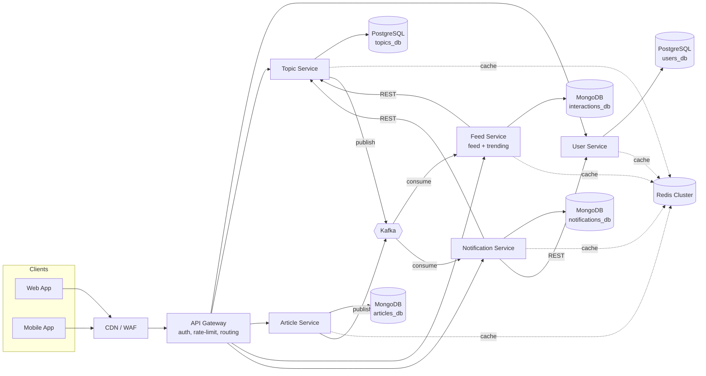
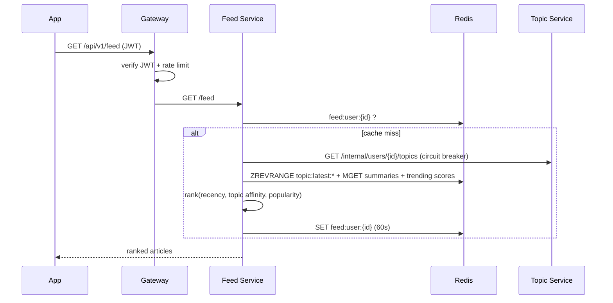
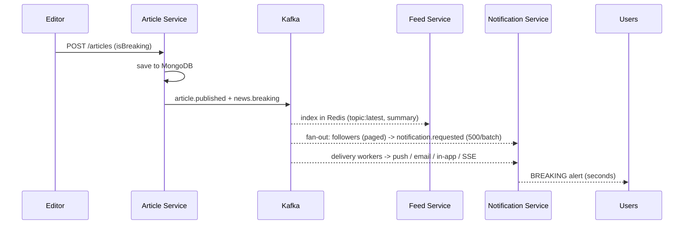

# Architecture - Personalized News Platform

Goal: serve **millions of users** with **continuously changing content**, personalised feeds, and instant breaking-news alerts.

## 1. System Architecture (services)

| Service | Responsibility | Owns data in |
|---|---|---|
| **api-gateway** | single entry point: JWT check, Redis-backed rate limiting, routing, blocks `/internal/*` | – |
| **user-service** | accounts, auth, preferences, device tokens | PostgreSQL |
| **topic-service** | topic catalogue, follow/unfollow, follower lookup | PostgreSQL + Redis |
| **article-service** | publish/edit/read articles, accept interactions, emit events | MongoDB + Redis |
| **feed-service** | personalised feed ranking, **trending**, bookmarks/history | Redis + MongoDB |
| **notification-service** | fan-out + delivery (push/email/in-app/SSE) | MongoDB + Redis |

Principles: *database per service*, stateless services (all state in DB/Redis/Kafka), sync REST for queries, async events for everything that can wait.

## 2. REST API Communication

* **Client → backend:** only via gateway, `/api/v1/*`, JSON, JWT bearer. See `docs/API.md`.
* **Service → service (sync):** REST on `/internal/*` protected by `x-internal-token`, using a client with **timeout, retry + backoff and a circuit breaker** (`packages/common/src/http.js`). Example: feed-service → topic-service `GET /internal/users/:id/topics`.
* **Async:** anything that doesn't need an immediate answer goes through Kafka (see §5).

## 3. Database Selection (polyglot persistence)

| Data | Store | Why |
|---|---|---|
| **Users, preferences, device tokens** | **PostgreSQL** | relational, ACID (registration = user + prefs in one transaction), unique email; read replicas for scale |
| **Topics & follows** | **PostgreSQL** | many-to-many with FK integrity; two indexes serve both "what do I follow" and "who follows X" |
| **Articles** | **MongoDB** | flexible document schema (varied sources/media), compound index `topics + publishedAt`, text search, sharding for huge volume |
| **Interactions** (view/like/share/bookmark) | **MongoDB** (append-only, TTL 90d) → Cassandra/ClickHouse at extreme scale | very write-heavy, time-ordered; no joins needed |
| **Notifications inbox** | **MongoDB** (TTL 30d) | per-user documents, auto-expiry |
| **Cache, trending, latest-by-topic, rate limits, pub/sub** | **Redis** | sub-ms reads, sorted sets for rankings, TTL, atomic counters |
| **Events** | **Kafka** | durable, replayable, partitioned log |

## 4. Caching Strategy

| What | Key | Structure | TTL | Invalidation |
|---|---|---|---|---|
| Trending news | `trend:<scope>:<bucket>` + `trending:*` result | Sorted set per 5-min bucket; result cache | buckets 25h, result **15s** | time-based (self-expiring) |
| Popular articles | `article:<id>` / `article:summary:<id>` | JSON | 5 min / 24h | on edit (`topic.updated` event + explicit delete) |
| Latest per topic | `topic:latest:<topicId>` | Sorted set (newest 500) | – | pushed on `article.published` |
| Frequently accessed topics | `topics:all`, `topic:<id>`, `follows:<user>` | JSON | 1h / 10 min | on write |
| Personal feed | `feed:user:<id>` | JSON | 60s | expiry |
| Article lists | `articles:list:*` | JSON | 20s | expiry |

Layers: **CDN** (`Cache-Control`, `stale-while-revalidate`) → **Redis** → **DB**.
Protections (`packages/common/src/cache.js`): *TTL jitter* (avoid avalanche), *single-flight lock* (avoid stampede on a hot breaking story), *negative caching* (avoid penetration), *fail-open* if Redis is down. Redis runs with `allkeys-lru` eviction.

## 5. Messaging (Kafka)

| Topic | Producer | Consumers (group) | Purpose |
|---|---|---|---|
| `article.published` | article-service | feed (index hot data), notification (low-priority in-app) | new articles |
| `news.breaking` | article-service | feed, notification (**high-priority** group) | breaking news - separate stream so it is never queued behind normal traffic |
| `topic.updated` | topic/article-service | feed (invalidate caches) | topic & content changes |
| `user.interaction` | article-service | feed (history + trending) | analytics without slowing reads |
| `notification.requested` | notification fan-out | notification delivery workers | batches of ≤500 users |

* Envelope: `{eventId, type, occurredAt, payload}`; **key = topicId/articleId** keeps related events ordered per partition.
* Producer: idempotent, `acks=all`, gzip. Consumers: retry w/ backoff → **dead-letter topic** (`<topic>.dlq`).
* **Two-stage notification pipeline:** `news.breaking` → *fan-out* (page through followers, de-dupe in Redis) → `notification.requested` (500 users/event) → *delivery workers* (batch FCM/SES + in-app + SSE). Fan-out is decoupled from delivery so each scales on its own.

## 6. Scalability - handling breaking-news traffic spikes

1. **Stateless services + autoscaling** - Kubernetes HPA (CPU 60 %, scale-up 100 %/15 s, slow scale-down); notification workers scale on **Kafka lag** with KEDA (`infra/k8s/`).
2. **Absorb reads at the edge** - CDN caches `/trending`, `/articles/:id`, `/topics` for 15-300 s with `stale-while-revalidate`; a viral article is served from the CDN, not our servers.
3. **Cache-first reads** - hot article/feeds/trending come from Redis; single-flight locks collapse thousands of identical misses into one DB query.
4. **Writes go async** - interactions and notifications are queued in Kafka; the DB is never in the request path of a "like" or a push.
5. **Protect the system** - gateway rate limits (per user/IP, Redis-shared), circuit breakers + timeouts so a slow dependency fails fast, graceful degradation (feed falls back to latest-global if topic-service is down), load shedding via 429.
6. **Data tier scaling** - PostgreSQL primary + read replicas (+ PgBouncer); MongoDB replica set → sharded by `topics/publishedAt`; Redis Cluster; Kafka partitions (12-48) allow that many parallel consumers.
7. **Efficient algorithms** - keyset pagination (no OFFSET), batched lookups (`MGET`, `ANY($1)`), bulk inserts, precomputed per-topic latest lists, bucketed trending.
8. **Resilience / HA** - multi-AZ, replication factor 3, `maxUnavailable: 0` rolling deploys, readiness/liveness probes, DLQs, idempotent consumers (Redis de-dupe).
9. **Observability** - structured logs, `/health` + `/ready`; in production add Prometheus/Grafana (RPS, p95, cache hit-rate, Kafka lag) with alerts.
